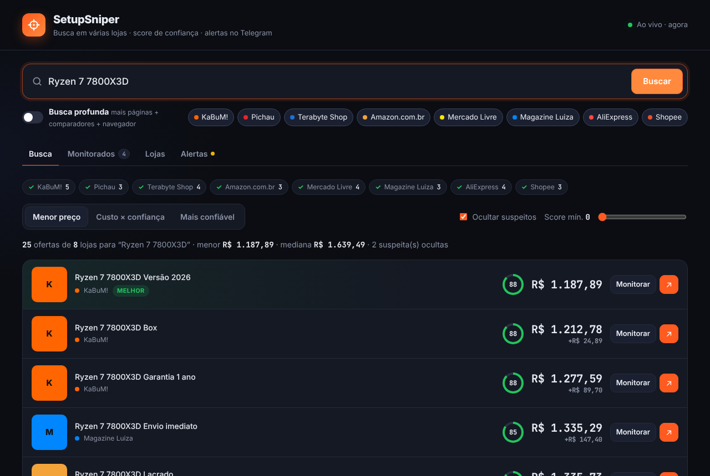
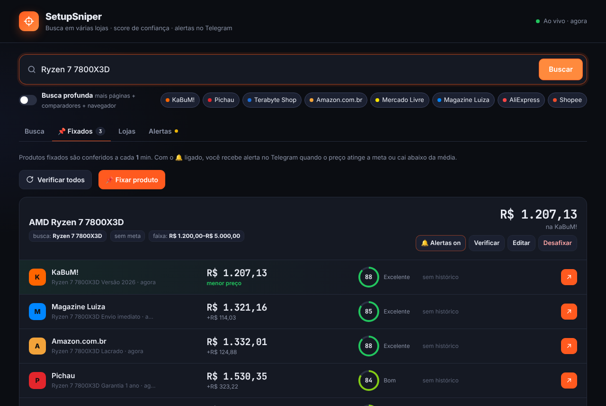

<div align="center">

# 🎯 SetupSniper

**Caçador de preços de hardware.** Busca em várias lojas brasileiras ao mesmo tempo, mostra um **score de confiabilidade** de cada loja e avisa no **Telegram** quando o preço cai.

Roda no seu PC ou num **celular Android antigo** usado como servidor pessoal, que também pode virar a sua **nuvem de arquivos**.

[](https://github.com/phs-analytics/SetupSniper/actions/workflows/ci.yml)


[Começar](#-começar-em-2-minutos) · [Celular como servidor](docs/celular-servidor.md) · [Telegram](docs/telegram.md) · [Nuvem](docs/nuvem.md) · [FAQ](docs/faq.md)

</div>



## ✨ O que ele faz

| | |
|---|---|
| 🔎 **Busca livre** | Digite qualquer produto e os resultados de cada loja aparecem conforme ela responde. |
| 🛒 **8 lojas + 2 comparadores** | KaBuM!, Pichau, Terabyte, Amazon, Mercado Livre, Magalu, AliExpress e Shopee. Na **busca profunda**, também Buscapé e Zoom. |
| 🛡️ **Score de confiabilidade** | De 0 a 100 por loja, combinando Reclame Aqui, avaliação, volume de vendas e reviews. |
| 🧹 **Filtro de lixo** | Descarta acessórios e marca como **suspeito** o preço bom demais para ser verdade. |
| 📌 **Fixar produtos** | Fixe uma oferta com **meta de preço**. O servidor confere de tempos em tempos e guarda o histórico. |
| 🔔 **Alertas no Telegram** | Avisa quando o preço atinge a meta ou cai abaixo da média. Também dá para fixar produtos pelo próprio bot. |
| ↗️ **Link direto** | O botão "Ver na loja" leva direto à página do produto. |
| 📱 **Servidor no celular** | Scripts para Termux: liga sozinho, reinicia se cair, tem um vigia que religa tudo a cada 15 min e atualiza pelo Telegram. |
| ☁️ **Nuvem de arquivos** | Opcional: seus arquivos no celular servidor, acessíveis pelo navegador ou por WebDAV. |
| 🔒 **Privado** | Nenhum dado sai da sua máquina. Zero dependências e zero contas. |



## 🚀 Começar em 2 minutos

Precisa do **Node.js 18.18+**. Não tem `npm install`.

```bash
git clone https://github.com/phs-analytics/SetupSniper.git
cd SetupSniper
cp .env.example .env        # defina uma SENHA
npm start                   # abra http://localhost:3000
```

Quer só conhecer a interface? Rode `npm run demo` (preços simulados).

## 📚 Guias

| Guia | Para quê |
|---|---|
| [Instalação no computador](docs/instalacao.md) | Windows, macOS, Linux e Docker |
| [Celular como servidor](docs/celular-servidor.md) | Android antigo + Termux + Tailscale, rodando 24h |
| [Alertas no Telegram](docs/telegram.md) | Criar o bot, regras de alerta e comandos |
| [Nuvem de arquivos](docs/nuvem.md) | Seus arquivos no servidor, pelo navegador ou WebDAV |
| [Como funciona](docs/como-funciona.md) | Leitura de preços, filtros, score e API |
| [Adicionar uma loja](docs/adicionar-loja.md) | Passo a passo para contribuir com uma loja nova |
| [Perguntas frequentes](docs/faq.md) | Lojas bloqueadas, preços diferentes e segurança |

## 🔒 Privacidade e segurança

- **Seus dados ficam só com você.** Token do Telegram, senhas, fixados e histórico ficam em arquivos que **nunca vão para o git**. O `npm run check` e o CI conferem isso.
- **Proteja o acesso.** Defina `SENHA` e acesse de fora de casa só pelo [Tailscale](https://tailscale.com). Não abra portas no roteador.
- **Detalhes:** veja o [SECURITY.md](SECURITY.md).

## 🤝 Contribuindo

Lojas mudam de layout o tempo todo, então correções de adaptadores são muito bem-vindas! Veja o [CONTRIBUTING.md](CONTRIBUTING.md). Para rodar os testes: `npm test` e `npm run check`.

## ⚠️ Avisos

- **Os preços são lidos de páginas públicas.** Se uma loja mudar o layout ou bloquear o acesso, só aquela loja é afetada.
- **Os indicadores de confiabilidade em `data/stores.json` são estimativas iniciais.** Ajuste conforme a sua pesquisa.
- **Projeto pessoal, sem vínculo com as lojas citadas.** Confira sempre preço, vendedor e frete na loja antes de comprar.

## 📄 Licença

[MIT](LICENSE)
